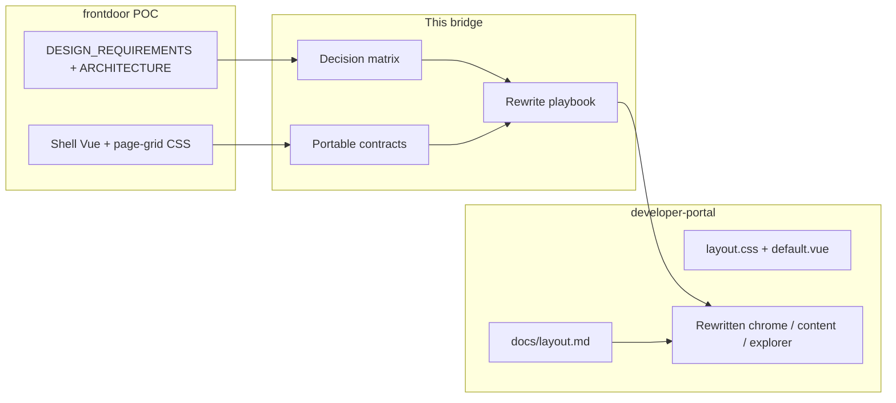

# Migration bridge — Front Door → developer-portal

How to **preserve chrome, grid, and content-layout design decisions** when moving work into the production Nuxt app:

**[repos/technical-documentation/developer-portal](https://gitlab.wikimedia.org/repos/technical-documentation/developer-portal)**

This document is a **rewrite bridge**, not a packaging plan. Treat it like a lockfile of decisions: update a row when chrome polish lands here, and map it to `adopted` / `diverged-on-purpose` / `not-yet` / `open` when production owns or rejects it.

**Explorer layout:** Community API Explorer page geometry and project-settings chrome are defined on [PR #74](https://github.com/mooeypoo/poc-wikimedia-frontdoor/pull/74) (`design-explorer-improvements`) — see the **Explorer layout / grid** matrix and playbook step 3. That work must be **rewritten into** developer-portal, not left as “shell only.”

---

## Hard constraints (production engineering)

From developer-portal `README.md` / conventions (still apply when replacing chrome):

1. Frontdoor is **reference only** — **not** an npm dependency and **not** a Nuxt layer.
2. Code moves across **only after being rewritten** to production conventions (`$msg`, Codex tokens, logical CSS, their lint); **nothing is copied as-is**.
3. Prefer **one** shell geometry stylesheet in production (`layout.css`) when rewriting — fold rules in; do not reintroduce a frontdoor-style forest of `shell-*.css` files unless production docs change.

**Do not:**

- Publish `@wikimedia/frontdoor-shell` (or any shared Nuxt module) for developer-portal to depend on.
- Paste `Shell*.vue` / `page-grid.css` verbatim into GitLab without a rewrite pass.

### Design status (authoritative for this bridge)

Production `docs/status.md` marks shell **wiring** steps done (grid skeleton, brand, menus, footer landmarks). That is **not** the same as a finished design.

Production’s current header/menu implementations are a scaffold to **replace with rewrite**. Prefer swapping rewritten components over surgically patching the scaffold.

**Design lock (2026-11-27):** Project design signed off on the geometry / chrome rows in [Design lock](#design-lock-2026-11-27). Scaffold values that disagree (704px prose, 281px side nav, 1280px TOC, document scroll, never-collapsing top menu, etc.) are **rejected** — do **not** mark them `diverged-on-purpose`. Matrix status for locked items is **`not-yet`** until production rewrites them to match (`adopted`).

**Landing page:** Layout for the platform home is **deliberately deferred** until design reaches a final status for that surface. Ignore prior landing-only measure / band / exception work. Do **not** migrate landing layout from frontdoor until that lock lands here.

---

## Status values

| Status | Meaning |
|--------|---------|
| `adopted` | Production owns **design-approved** equivalent behaviour under its conventions |
| `wiring-only` | Production has landmarks / structure, but **design is not final** — expect replace-with-rewrite |
| `diverged-on-purpose` | Design has **explicitly** accepted production’s different choice — do not port |
| `not-yet` | Design is decided (often frontdoor); production does not own the rewritten behaviour yet |
| `open` | Design must still choose before / during replace |
| `deferred` | Out of scope until design revisits (e.g. landing page layout) |

---

## Design lock (2026-11-27)

Signed off by project design. Production rewrite must match these values.

| # | Topic | Locked decision |
|---|-------|-----------------|
| 1 | Scroll model | Fixed chrome + **independent** start / body scrollports (not document scroll) |
| 2 | Standard prose max | **792px** documentation measure. **Landing layout deliberately deferred** until design reaches a final status for that surface |
| 3 | Side nav | **241px** allocation (incl. exterior margin); expand from **961px** (docs) / **1120px** (Explorer) |
| 4 | Narrow primary nav | Measure → hamburger + breadcrumbs + overlay (primary, then section) |
| 5 | On-this-page TOC | End panel from **1202px** (frontdoor arithmetic) |
| 6 | Explorer width ≥1680 | Body tops out inside **1512** grid (~**1240px** with start + 40px gap); only exterior margins grow |
| 7 | Explorer vertical | **Continuous** scroll of specs in the **body scrollport** (natural-height Scalar; not a faux-iframe). See note below — no conflict once #1 is locked |
| 8 | Nav↔content gap | Single **40px** (`--spacing-250`) rule site-wide, **including** Explorer local-nav→Scalar |
| 9 | Header utilities | Collapse-all when search min no longer fits → search icon + ellipsis → full-screen search / language |
| 10 | Footer band | **Main column only** (not under TOC). **80px** (`2 × --spacing-250`) vertical space between page content and the footer |
| 11 | Desktop primary nav | Codex **quiet tabs** (panels hidden; navigation-only — keep correct link semantics) |
| 12 | Header status chip | Replace Prototype **warning** chip with label **Beta**, Codex InfoChip **`status="progressive"`** (keep label-only / hide status icon unless design reopens icons) |

### Note on #7 vs “document-scroll fight”

Earlier bridge text warned that continuous Explorer scroll might fight a **document-scroll** shell. That only mattered if production kept window/document scrolling while Explorer assumed an inner body scrollport.

With **#1 locked**, there is **no fight**:

- Header stays fixed; start nav and main band each scroll in their own ports.
- “Continuous page scroll for specs” means the Scalar shell **grows with content** and the user scrolls **`.frontdoor-shell__body-scroll`** (title → project settings → full spec), not a height-locked faux iframe and not the browser document.
- Back to top, Test Request shell clamp, and sticky TOC all target that body scrollport model.

### Deliberate deference — landing layout

Landing / platform-home layout (measure, full-bleed bands, hero, persona grids, etc.) is **out of scope for migration** until design marks that surface final. Prior frontdoor landing tokens and CSS are **not** rewrite inputs yet. When design locks landing, add rows here and flip `deferred` → `not-yet`.

### Still open / bundled

- Start-drawer expand motion details (bundled with locked collapse unless design drops motion).

POC implements locks **#10** / **#12**: `.frontdoor-shell__main` `padding-block-end: calc(2 * var(--spacing-250))`; `ShellHeaderBrand` **Beta** / `status="progressive"` (`brand-beta-chip-*`).

---

## Current production vs frontdoor (replace scaffold)

Scaffold values below are **superseded** by the design lock where noted. Rewrite and replace — do not keep scaffold numbers as `diverged-on-purpose`.

| Topic | Frontdoor (design locked) | developer-portal today (scaffold) | Bridge status |
|-------|---------------------------|-----------------------------------|---------------|
| Document scroll | Fixed chrome; independent start / body scrollports | Document scrolls; sticky regions | `not-yet` — **locked #1**; replace scroll model |
| Top (primary) menu when narrow | Measure + hamburger + breadcrumbs + overlay | Never collapses — horizontal overflow | `not-yet` — **locked #4** |
| Side menu collapse | Coupled to primary; docs **961px** / Explorer **1120px** | Alone below **640px** | `not-yet` — **locked #3** |
| Side menu width | **241px** allocation incl. exterior margin | Fixed **281px** | `not-yet` — **locked #3** |
| Explorer wide body | Start + **40px** gap + body inside **1512px**; Scalar native sidebar | Unbuilt / blank embed | `not-yet` — **locked #6/#8**; [PR #74](https://github.com/mooeypoo/poc-wikimedia-frontdoor/pull/74) |
| In-page TOC breakpoint | **1202px** | **1280px** | `not-yet` — **locked #5** |
| Standard prose / content max | **792px** | **704px** | `not-yet` — **locked #2** |
| Nav↔content / Explorer gap | **40px** site-wide | Body gutters / spans | `not-yet` — **locked #8** |
| Header utility collapse | Collapse-all + full-screen search/language | Never collapses | `not-yet` — **locked #9** |
| Desktop primary nav | Quiet tabs (navigation-only) | Links + overflow | `not-yet` — **locked #11** |
| Header status chip | **Beta** `progressive` (replace Prototype warning) | Brand wiring / no chip or different | `not-yet` — **locked #12** |
| Footer band | Main column only; **80px** content→footer gap | Footer wiring; width/gap may differ | `not-yet` — **locked #10** |
| Landing layout | — | — | `deferred` — deliberate until final landing design |
| Stylesheet shape | `page-grid.css` + `shell-*.css` + layout in `default.vue` | One **`layout.css`** | Prefer keep single file when replacing; fold rewritten rules in |
| Measured collapse thresholds | `ResizeObserver` + config px | Scaffold forbids measured top-menu thresholds | `not-yet` — required by **#4/#9**; rewrite must meet production a11y/lint |

**Replace preference:** When bringing a locked frontdoor decision across, **rewrite the production component (or layout region) and swap it in** — do not nibble at the scaffold with one-off CSS patches that fight `layout.css` and goldens.

---

## Decision matrix (chrome + standard grids)

Update this table when chrome polish lands in frontdoor. Production MRs that rewrite a locked row should flip status to `adopted` and point at the production file.

### Layout geometry

| Decision | Frontdoor source | Status | Production home | Rewrite note |
|----------|------------------|--------|-----------------|--------------|
| Codex breakpoints 640 / 1120 / 1680 as layout anchors | `page-grid.css`, `DESIGN_REQUIREMENTS.md` → Layout system | `not-yet` | `docs/layout.md`, `layout.css` | Keep Codex mins; do not invent unpaired max-width twins |
| Nested standard content max **792px** | `--fd-layout-main-content-max-inline-size` | `not-yet` | `--dp-width-prose-max` **704px** (scaffold — reject) | **Locked #2** — replace prose measure with 792 |
| Landing content measure / bands | `config/landingSurfaces.ts`, landing CSS | `deferred` | — | **Deliberate deference** — wait for final landing design status before any rewrite |
| Nav region **241px** incl. exterior margin | `--fd-layout-navigation-region-inline-size` | `not-yet` | **281px** (scaffold — reject) | **Locked #3** |
| Nav→content min gap **40px** (`--spacing-250`) | `--fd-layout-navigation-content-min-gap` | `not-yet` | Body grid gutters / spans | **Locked #8** — same token as Explorer gap |
| Local nav expand floor **961px** (docs) | `SHELL_NAV_EXPANDED_LAYOUT_MIN_VIEWPORT_PX` | `not-yet` | Side column from **640px** (scaffold — reject) | **Locked #3** |
| Explorer local-nav floor **1120px** | `SHELL_NAV_EXPANDED_LAYOUT_MIN_VIEWPORT_EXPLORER_PX` ([PR #74](https://github.com/mooeypoo/poc-wikimedia-frontdoor/pull/74)) | `not-yet` | Unbuilt explorer | **Locked #3** |
| End TOC from **1202px** | `ON_THIS_PAGE_NAV_END_PANEL_MIN_VIEWPORT_PX` | `not-yet` | **1280px** (scaffold — reject) | **Locked #5** |
| Desktop-wide grid cap **1512px**; exterior margins grow | `--fd-layout-grid-max-inline-size` | `not-yet` | Cap idea present; tokens differ | **Locked #6** for Explorer body too |
| Independent start / body scrollports | `default.vue`, `DESIGN_REQUIREMENTS.md` → Shell scroll | `not-yet` | Document scroll (scaffold — reject) | **Locked #1** — replace scroll model with rewrite |
| Page margins 16 / 24 / 32 by breakpoint | `--fd-layout-page-margin` | `not-yet` | `layout.css` page margins | Codex spacing tokens |
| Transparent start panel + `border-inline-end` muted | `default.vue` `.frontdoor-shell__side-panel--start` | `not-yet` / verify | Side menu chrome | Rewrite border on scrollport/panel |
| Scroll-end **32px** spacer via `::after` on scrollport | `shell-start-nav-scroll.css`, overlay | `not-yet` | Sticky nav regions | Nav scrollports under locked #1; distinct from footer content gap |
| Footer **main column only** + **80px** content→footer gap | `ShellSiteFooter`; main `padding-block-end: calc(2 * var(--spacing-250))` | `not-yet` | Footer | **Locked #10** — not under TOC; distinct from footer inner 32px bottom inset |

### Header / brand / utilities

| Decision | Frontdoor source | Status | Production home | Rewrite note |
|----------|------------------|--------|-----------------|--------------|
| Two-row header (brand/utilities; then primary nav) | `default.vue`, `DESIGN_REQUIREMENTS.md` | `wiring-only` | `docs/layout.md` | Keep two-row structure; replace chrome contents |
| Brand mark + Montserrat wordmark (self-hosted) | `ShellHeaderBrand`, `config/brandTypography.ts` | `wiring-only` | Brand wiring present | Keep self-hosted fonts; visual polish may still replace |
| Label-only **Beta** chip, `status="progressive"` | `ShellHeaderBrand`, `brand-beta-chip-*` | `not-yet` | Brand chip | **Locked #12** — `$msg` Beta; Codex progressive; keep label-only icon hide unless design reopens |
| Utility collapse-all + full-screen search/language | `useHeaderUtilityCollapse`, Codex exception #15 | `not-yet` | Scaffold never collapses | **Locked #9** — replace utility components |
| Collapsed ellipsis utility menu: **outside** inline-end inset | `ShellHeaderUtilityActions` `margin-inline-end` | `not-yet` | Header utilities | Surrounding spacing only — not padding inside Codex icon-only |
| Color theme Light / Dark / System via radios | `useColorMode`, `ShellColorThemePreferences` | `wiring-only` | Header colour theme | Replace control chrome if design differs; keep theme semantics |
| Interface language BiDi / autonyms | Lookup + `isolatePickerLabel` / `<bdi>` | `wiring-only` | Language picker | Production `$msg`; avoid Floating UI traps (#8) when replacing |

### Primary + section navigation

| Decision | Frontdoor source | Status | Production home | Rewrite note |
|----------|------------------|--------|-----------------|--------------|
| Quiet tabs as primary nav (panels hidden) | `ShellPrimaryNav`, Codex exception | `not-yet` | Links + overflow | **Locked #11** — rewrite site menu as quiet tabs; keep link semantics (not tablist) |
| Dual collapse → overlay primary then section | `useShellCollapsedNavMenu`, overlay | `not-yet` | Side hamburger only | **Locked #4** — replace; focus trap + scroll lock carefully |
| Landing / account: no fake crumb; visible **Menu** | `shell-collapsed-nav-menu-visible-label` | `not-yet` | Side control labeling | On replace: `$msg` “Menu” — never invent a location crumb |
| Breadcrumb fit hides subsection before primary ellipsis | `useShellCollapsedNavigationBreadcrumbFit` | `not-yet` | N/A in scaffold | **Locked #4** package |
| Start drawer expand only (instant collapse) | `shell-start-nav-reveal.css`, `SHELL_NAV_DRAWER_EXPAND_DURATION_MS` | `not-yet` | Different narrow behaviour | Ship with locked collapse unless design drops motion |
| `CdxMenuItem` outside `CdxMenu` for static lists | `ShellSidePanelNav` | `open` | Side menu implementation | Document Codex exception if replacement uses standalone MenuItem |

### On-this-page TOC

| Decision | Frontdoor source | Status | Production home | Rewrite note |
|----------|------------------|--------|-----------------|--------------|
| Show when ≥ **3** `h2`s; nest through `h3` | `ON_THIS_PAGE_NAV_MIN_H2_COUNT` | `wiring-only` | `MINIMUM_SECTIONS` | Align with design + real content |
| Wide: CSS sticky end list from **1202px** | `ShellOnThisPageNav`, `.frontdoor-shell__on-this-page-end` | `not-yet` | Sticky / **1280px** scaffold | **Locked #5**; preserve sticky containing-block lesson |
| Narrow: quiet MenuButton | `ShellOnThisPageMenuButton` | `wiring-only` | Control above page | Replace chrome; keep `$msg` labels |
| TOC top padding **24px** (`--spacing-150`) | `ShellOnThisPageNav` | `not-yet` | In-page nav chrome | Port as spacing token if still needed |
| Scrollspy progressive + jump suspension | `useOnThisPageNav` | `not-yet` | — | Rewrite behaviour; do not copy composable blindly |
| Footer main-only + **80px** (`2 × --spacing-250`) above footer | `ShellSiteFooter`; design lock #10 | `not-yet` | Footer | **Locked #10** — reject Figma main+end span; enforce content→footer gap |

### Content page patterns (rewrite candidates)

| Decision | Frontdoor source | Status | Production home | Rewrite note |
|----------|------------------|--------|-----------------|--------------|
| Content `h1`/`h2`/`h3` Codex type; `h2` **40px** start; site `h3` **32px** | `main.css` `.fd-content-page` | `not-yet` | `prose.css` | Re-express in production prose tokens; prose max **792** locked |
| Internal vs external **NavigationCard** rules | `AGENTS.md` playbook, `NavigationCard.vue` | `not-yet` | `app/components/content/` | Rewrite MDC/API; keep writer supporting-text rules |
| **LinkRow** for link-only rows (24px gap) | `LinkRow.vue` | `not-yet` | content components | Not a second card component |
| **Highlight** progressive-subtle CTA surface | `Highlight.vue`, `.fd-highlight` | `not-yet` | — | Approved bespoke; Codex has no padded progressive surface |
| **CodeBlock** / **CodeTabs** bordered soft-wrap `dir=ltr` | `CodeBlock.vue`, `CodeTabs.vue` | `not-yet` | prose / content | Fence lang allowlist; no bare fences on authored pages |
| Callouts via `CdxMessage` | `Callout` content component | `not-yet` | Curated content components | Prefer Codex Message |

### Explorer layout / grid ([PR #74](https://github.com/mooeypoo/poc-wikimedia-frontdoor/pull/74))

**Design source of truth for the community API Explorer page geometry and project-settings chrome.** Branch: `design-explorer-improvements`. Production does not own this layout yet — rewrite into `blank` (or equivalent) + `layout.css`; **replace** any scaffold explorer embed rather than patching prose columns.

| Decision | Frontdoor source | Status | Production home | Rewrite note |
|----------|------------------|--------|-----------------|--------------|
| Explorer on client-only / blank-like shell (`ssr: false`) | `nuxt.config` `routeRules`, wide body (not 792px prose) | `not-yet` | `blank` layout + `docs/api-reference.md` | Do not force explorer into finished `default` prose shell |
| End column collapsed; Scalar **native** endpoint sidebar | `EXPLORER_USE_INTERNAL_SCALAR_SIDEBAR`, `frontdoor-shell--explorer-internal-sidebar` | `not-yet` | API reference embed | Prefer Scalar sidebar; custom module rail is rollback-only |
| Project controls + Scalar share the **same body inline edge** | `default.vue` explorer body columns, `explorer/[...view].vue` | `not-yet` | Unbuilt explorer | One wide main band |
| Wide body capped inside **1512px**; exterior margins beyond | `--fd-layout-explorer-body-columns-max-inline-size` / `-collapsed-…` | `not-yet` | — | **Locked #6** — ≈ **1240px** body when start expanded |
| Expanded local-nav → Scalar gap **40px** | `--fd-layout-explorer-navigation-content-gap` | `not-yet` | — | **Locked #8** — same 40px site-wide rule |
| Explorer local-nav expand floor **1120px** | `SHELL_NAV_EXPANDED_LAYOUT_MIN_VIEWPORT_EXPLORER_PX` | `not-yet` | — | **Locked #3** |
| Natural-height Scalar; scroll = **body scrollport** | `DESIGN_REQUIREMENTS.md` → API Explorer page layout | `not-yet` | — | **Locked #7** with **#1** — continuous spec scroll in body port |
| Intro → Scalar stack gap: **16px** &lt;640 / **24px** ≥640 | `.explorer-page` gaps in `explorer/[...view].vue` | `not-yet` | — | Parent owns gap; project-controls stack has no trailing gap |
| Project-controls surface: neutral-subtle + exploratory **4px** radius | `config/explorerSurfaces.ts`, `--fd-explorer-controls-surface-*` | `not-yet` | — | Shared radius consumers if those land too |
| Minimized / Accordion project settings (Adjust, Include, API Combobox + chips) | `ExplorerProjectControls`, `useExplorerProjectSettings*`, Codex #14 / #16 | `not-yet` | — | Rewrite UX; banana → `$msg` |
| Floating **Back to top** (32px / 16px insets) | `useExplorerBackToTop`, `EXPLORER_BACK_TO_TOP_*` | `not-yet` | — | Targets body scrollport under locked #1/#7 |
| Write-request warning + confirm dialog patterns | Scalar client composables / Codex #13 | `not-yet` | — | Rewrite with production enhancement rules |

---

## Portable contracts (rewrite inputs — not runtime deps)

Stable **intent** a rewrite can reimplement. Names may become `--dp-*` / `$msg` keys; values and responsibilities must not silently drift.

### Layout intent tokens

| Intent | Frontdoor symbol | Notes for production |
|--------|-----------------|----------------------|
| Desktop-wide outer cap | `--fd-layout-grid-max-inline-size` (1512px) | **Locked #6** — Explorer body stays inside this; exterior margins grow |
| Standard content max | `--fd-layout-main-content-max-inline-size` (792px) | **Locked #2** — replace scaffold 704px |
| Nav allocation | `--fd-layout-navigation-region-inline-size` (241px) | **Locked #3** — replace scaffold 281px |
| Nav→content minimum gap | `--fd-layout-navigation-content-min-gap` (40px) | **Locked #8** — site-wide |
| Explorer local-nav→body gap | `--fd-layout-explorer-navigation-content-gap` (40px) | **Locked #8** — same as nav/content min |
| Explorer body max (expanded nav) | `--fd-layout-explorer-body-columns-max-inline-size` | `1512 − start panel − 40px gap` |
| Explorer body max (collapsed nav) | `--fd-layout-explorer-body-columns-collapsed-max-inline-size` | Full **1512px** grid |
| Docs local-nav floor | `SHELL_NAV_EXPANDED_LAYOUT_MIN_VIEWPORT_PX` = 961 | **Locked #3** |
| Explorer local-nav floor | `SHELL_NAV_EXPANDED_LAYOUT_MIN_VIEWPORT_EXPLORER_PX` = 1120 | **Locked #3** |
| TOC end-panel floor | `ON_THIS_PAGE_NAV_END_PANEL_MIN_VIEWPORT_PX` = 1202 | **Locked #5** |
| Page margin scale | `--fd-layout-page-margin` | 16 / 24 / 32 by breakpoint (not the nav↔content gap) |
| Explorer control surface | `EXPLORER_CONTROLS_SURFACE_*` / `--fd-explorer-controls-surface-*` | Neutral-subtle bg; exploratory **4px** radius |
| Back to top insets | `EXPLORER_BACK_TO_TOP_*` | 32px viewport block-end; 16px shell inline-end |
| Search collapse floor | `HEADER_SEARCH_INPUT_MIN_INLINE_SIZE_PX` = 256 | **Locked #9** |
| Content→footer vertical gap | `2 × --spacing-250` = **80px** | **Locked #10** — between last page content and footer band |
| Header status chip | Label **Beta**; `CdxInfoChip` `status="progressive"` | **Locked #12** — replace Prototype / warning |
| TOC min `h2` count | `ON_THIS_PAGE_NAV_MIN_H2_COUNT` = 3 | Align with content |
| Drawer duration (if used) | `SHELL_NAV_DRAWER_EXPAND_DURATION_MS` = 250 | Codex medium transition |

### Chrome message keys (banana → `$msg`)

When rewriting chrome, ensure production has equivalents (en + qqq). Frontdoor keys to inventory against:

- Brand: `brand-wordmark-wikimedia`, `brand-wordmark-developer-portal`, `app-title`, `brand-beta-chip-label`, `brand-beta-chip-tooltip` (**locked #12**)
- Header utilities: `header-search-*`, `header-settings-*`, `header-preferences-label`, `header-language-*`, `header-utility-menu-label`, `header-login-label`, `header-logout-label`, `header-auth-link-aria`, `color-mode-*`
- Primary / collapsed nav: `nav-primary-label`, `shell-collapsed-nav-label`, `shell-collapsed-nav-menu-button-label`, `shell-collapsed-nav-menu-visible-label`, `shell-collapsed-nav-menu-overlay-label`, `shell-collapsed-nav-menu-back-button-label`
- On this page: `on-this-page-label`, `on-this-page-nav-aria`
- Footer: `footer-*`
- Explorer (from [PR #74](https://github.com/mooeypoo/poc-wikimedia-frontdoor/pull/74)): `explorer-title`, `explorer-description`, `explorer-project-settings-*`, `explorer-api-label`, `explorer-module-*`, `explorer-include-*` / opt-in labels, `explorer-back-to-top-label`, Scalar write-warning keys as needed

### Component responsibilities (reimplement, do not copy)

| Responsibility | Frontdoor | Production rewrite target |
|----------------|-----------|---------------------------|
| Page shell / landmarks + scrollports | `layouts/default.vue` + `PageGrid` | `layouts/default.vue` + `layout.css` — **locked #1** |
| Brand lockup | `ShellHeaderBrand` | Existing brand |
| Header utilities (collapse-all) | `ShellHeaderUtilityActions` | Replace — **locked #9** |
| Primary IA | `ShellPrimaryNav` | Quiet tabs — **locked #11**; narrow overlay — **locked #4** |
| Brand status chip | `ShellHeaderBrand` chip | **Beta** progressive — **locked #12** (not Prototype warning) |
| Section menu | `ShellSidePanelNav` | Side menu from `config/navigation.ts` — **241px / floors locked #3** |
| Collapsed nav + overlay | `ShellCollapsedNavigation` + overlay | **Locked #4** — dual-level overlay, not side-only hamburger |
| In-page TOC | `ShellOnThisPageNav` / MenuButton | In-page navigation — **1202px locked #5** |
| Footer band | `ShellSiteFooter` | Main-only + **80px** content gap — **locked #10** |
| Content cards / CTAs / code | `app/components/content/*` | `app/components/content/` curated set |
| Explorer page + wide grid | `explorer/[...view].vue`, `page-grid.css` explorer tokens | `blank` + explorer route + `layout.css` — [PR #74](https://github.com/mooeypoo/poc-wikimedia-frontdoor/pull/74); locks #6/#7/#8 |
| Explorer project settings | `ExplorerProjectControls` + compact/Include composables | New rewritten controls under production conventions |
| Explorer Back to top | `useExplorerBackToTop` | Body-scrollport target under locks #1/#7 |

### Responsive behaviour checklist (carry as tests / review notes)

- [ ] Logical CSS; no global RTL flipper for third-party explorer styles
- [ ] Interface strings via banana / `$msg` only
- [ ] External / content strings in `<bdi>` (or isolate) where shown in chrome
- [ ] **Locked #1:** independent start / body scrollports (not document scroll)
- [ ] **Locked #2:** documentation prose max **792px** (not 704)
- [ ] **Locked #3:** nav **241px**; docs floor **961px**; Explorer floor **1120px**
- [ ] **Locked #4:** measure → hamburger + breadcrumbs + overlay (primary then section)
- [ ] **Locked #5:** TOC end panel from **1202px**
- [ ] **Locked #6/#8:** Explorer body inside **1512**; **40px** nav↔content site-wide including Explorer
- [ ] **Locked #7:** natural-height Scalar; continuous scroll in body scrollport
- [ ] **Locked #9:** utility collapse-all → full-screen search / language
- [ ] **Locked #10:** footer main-column only; **80px** (`2 × --spacing-250`) between page content and footer
- [ ] **Locked #11:** desktop primary nav = quiet tabs (link semantics preserved)
- [ ] **Locked #12:** header chip = **Beta** / `status="progressive"` (label-only unless design reopens icons)
- [ ] Landing / no-primary-section: **Menu** (or equivalent) — never a fake first IA crumb
- [ ] Utility overflow: optical end inset is **margin outside** the button, not padding inside Codex icon-only
- [ ] TOC sticky: end column must form a tall containing block or sticky fails
- [ ] Document measurement vs overflow trade-offs in production `docs/layout.md` (required by #4/#9)
- [ ] Explorer (when built): blank/client shell; keep prose `default` layout coherent after chrome replace
- [ ] Landing layout: **deliberately deferred** — do not migrate until design locks final landing status

---

## Rewrite playbook (developer-portal MRs)

Prefer **replace rewritten components** over patching the scaffold. Geometry / chrome rows in the [design lock](#design-lock-2026-11-27) are mandatory for replace MRs.

### 1. Replace chrome regions (preferred)

For header, site menu, side menu, in-page nav, footer, and layout geometry:

1. Rewrite the region against production conventions using frontdoor as the behavioural/visual source (`Shell*`, `page-grid.css`, `DESIGN_REQUIREMENTS.md`) and the design lock values.
2. **Swap** the production component / layout rules in (update `layout.css` + Vue in one MR) rather than layering conflicting overrides.
3. Update production `docs/layout.md` / `docs/status.md` / browser goldens in the **same** change — scaffold docs (704 / 281 / 1280 / document scroll / never-collapse) must not outlive the replacement.
4. Flip matrix rows from `not-yet` / `wiring-only` / `open` → `adopted` (or `diverged-on-purpose` only if design explicitly keeps a scaffold choice — **not** for locked rows).

Do **not** treat production status “shell steps done” as a freeze on design-driven replacement.

### 2. Content chrome in parallel

Rewrite into `app/components/content/` under production conventions (`docs/content.md`, `prose.css`, curated MDC set):

1. Typography / section spacing (map **792** / 40 / 32 — prose max **locked #2**).
2. `NavigationCard` / grid (internal vs external supporting-text rules from `AGENTS.md`).
3. `LinkRow`, `Highlight`, `Callout` (`CdxMessage`), `CodeBlock` / `CodeTabs`.
4. Catalog patterns after base content components exist. **Landing patterns:** deliberately deferred until design locks final landing status.

### 3. Explorer on `blank` (or equivalent) — migrate [PR #74](https://github.com/mooeypoo/poc-wikimedia-frontdoor/pull/74) layout

Port explorer **page layout / grid** and project-settings chrome as **new rewritten work** (not a copy of `ExplorerProjectControls.vue` / `page-grid.css`):

1. **Shell / route:** production `blank` (or client-only) layout sharing the **locked #1** scrollports — do not overload `default` prose **792** columns.
2. **Grid (required — locks #3/#6/#8 + PR #74):**
   - Wide body exception inside the **1512px** Codex desktop-wide cap: `start navigation + 40px Explorer gap + body`; exterior margins only beyond that.
   - Expanded local-nav → Scalar/controls gap = **40px** (site-wide rule).
   - Explorer-only local-nav floor **1120px**.
   - Collapse the end column when using Scalar’s native sidebar; project controls and Scalar share one body edge.
3. **Vertical (locked #7):** natural-height Scalar; continuous scroll in the body scrollport (no faux-iframe).
4. **Page stack:** title/description → project settings → Scalar reference; intro→Scalar gap **16px** mobile / **24px** tablet+.
5. **Project settings + Back to top + write warnings:** rewrite UX from #74 / `DESIGN_REQUIREMENTS.md` → API Explorer; `$msg` + Codex; enhancements per production `docs/architecture.md`.
6. Cite frontdoor sources ([PR #74](https://github.com/mooeypoo/poc-wikimedia-frontdoor/pull/74), `page-grid.css` explorer tokens, `DESIGN_REQUIREMENTS.md` → Explorer layout) in the MR; do not vendor Vue files. Flip matrix rows to `adopted` when production owns the rewritten layout.

### 4. Hygiene for every port / replace MR

1. Find the matrix row(s); set status.
2. Rewrite against production lint (`logical properties`, Codex tokens, `$msg` + qqq).
3. Replace components/layout regions rather than one-off patches that fight goldens.
4. Update production layout/status docs + goldens in the same MR.
5. Cover applicable items on the responsive behaviour checklist.

### 5. When frontdoor adds chrome polish

Same day: **add a matrix row** here (`not-yet` or `open`). Plan the production change as a **component replace**, not a copy of the SFC. If design signs off, add a line under [Design lock](#design-lock-2026-11-27).

---

## Source map (where to read first)

| Concern | Frontdoor | Production |
|---------|-----------|------------|
| Agent rules | `AGENTS.md`, `DESIGN_REQUIREMENTS.md` | `AGENTS.md`, `docs/conventions.md` |
| Layout / chrome | `ARCHITECTURE.md` → Shell; `page-grid.css`; `Shell*` | `docs/layout.md`, `layout.css` |
| Status / plan | This file + design lock + design PRs | `docs/status.md` |
| Content authoring | `docs/content-authoring-guide.md` | `docs/content.md` |
| Explorer layout / grid | **[PR #74](https://github.com/mooeypoo/poc-wikimedia-frontdoor/pull/74)** (`design-explorer-improvements`); `DESIGN_REQUIREMENTS.md` → Explorer layout + API Explorer page layout; `page-grid.css` `--fd-layout-explorer-*`; `config/shellNavigation.ts` explorer floor; `config/explorerSurfaces.ts` | `docs/api-reference.md`, `docs/ssr-migration.md`, future `layout.css` explorer rules |
| Explorer / Scalar behaviour | `ARCHITECTURE.md` → API explorer; `docs/adr-*` | Same + enhancement rules in `docs/architecture.md` |

---

## Success criteria

- A reviewer can open this matrix and see locked design values, what is still `open` / `deferred`, and whether production has rewritten each row to `adopted`.
- Locked scaffold conflicts (704 / 281 / 1280 / document scroll / never-collapse) are treated as **replace targets**, not permanent divergences.
- New chrome polish in frontdoor gets a matrix row the same day and is planned as a **component replace** in production, not a verbatim copy.
- Explorer / chrome work in developer-portal can cite frontdoor sources without importing code.
